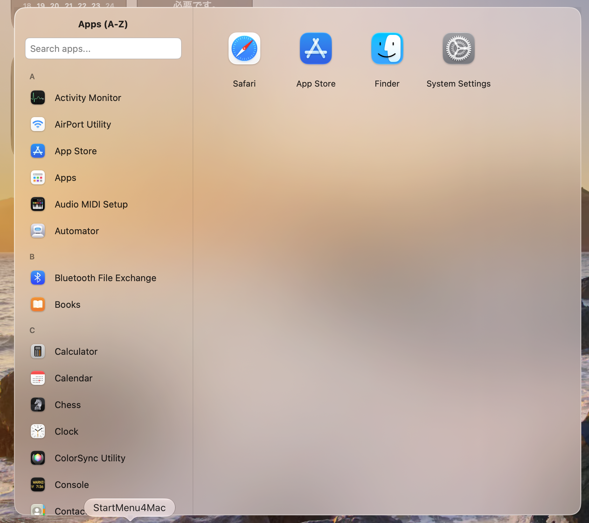

<p align="center">
  
</p>

<h1 align="center">StartMenu4Mac</h1>

<p align="center">A macOS application that provides a side-by-side view of your installed apps and pinned items (apps and folders), with an experience similar to the Windows Start Menu.</p>

[日本語](README.ja.md)

<p align="center">
  
</p>

It was heavily inspired by "SideBySide2" from [Windhawk](https://github.com/ramensoftware/windhawk).

This is currently a beta version. Features and behavior are subject to change. Testing on various Mac environments is welcome.

## Key Features

- Detection of installed macOS applications (including those within subfolders)
- Search by application name
- List of applications sorted alphabetically
- Pinning, reordering, and launching of applications
- Creation and editing of pinned folders
- Opening/closing the menu via the Dock, menu bar, or a global keyboard shortcut
- Automatic launch at login (via macOS Login Items)
- Handling of missing pins and applications explicitly identified as incompatible
- Local storage for settings, pins, and application caches

## Development Status

The current development baseline is `0.29.15-beta` (build `102`), targeting macOS 15.6. The Xcode project is the source of truth for the version/build and may be newer than this README. This source repository does not provide a signed/notarized binary distribution or a Mac App Store release.

## Building and Verification

Requirements include macOS 15.6 or later and Xcode (with the macOS SDK).

You can open `StartMenu4Mac.xcodeproj` in Xcode or build the project using the following command:

```bash
xcodebuild -project StartMenu4Mac.xcodeproj -scheme StartMenu4Mac -configuration Debug build CODE_SIGNING_ALLOWED=NO
```

Run `bash scripts/check.sh` for the available build and translation checks. The private development checkout also runs XCTest; the public source export intentionally excludes the private test suite, so its check performs a Debug build instead. Before a release or handing off work to others, run `bash scripts/check.sh --full` to verify Debug/Release builds and generated application metadata and resources. These checks run locally without Git synchronization.

## Translations

For in-app translations, we use Apple’s standard `.lproj/Localizable.strings` files. Please refer to [CONTRIBUTING.md](CONTRIBUTING.md) for instructions on how to add and review translations.

## Contributing

We welcome small, focused contributions to the code, documentation, or translations. Please review [CONTRIBUTING.md](CONTRIBUTING.md) before submitting any changes.

## License

**StartMenu4Mac is source-available, not OSI-approved open-source software.**
See [LICENSE](LICENSE) for the binding license terms.

Personal use, modification, free forks, and free redistribution are allowed.
Companies may use and modify StartMenu4Mac internally, including as an
incidental tool in profit-making operations. Redistributing a copy (including a
free modified copy) requires offering its corresponding source to recipients
without charge; public GitHub publication of private internal modifications is
not required.

Without separate written permission, selling or otherwise monetizing
StartMenu4Mac, a modified version, or an output the app creates or materially
transforms is prohibited. Paid access, hosted provision, or a product or service
whose material value is the app, its functionality, or such an output is also
prohibited. Ordinary goods and services made in separate apps or business
processes may still be sold when StartMenu4Mac is only an incidental internal
launcher or organizer and does not create or materially transform, accompany,
or provide access to what is sold. A company’s other revenue-generating activity
is not prohibited just because it installs or uses StartMenu4Mac internally.

A visible author credit is appreciated, but optional; falsely claiming
authorship or official endorsement is prohibited.

The project is provided as-is, **without warranty or guaranteed support**.
Contributions to the upstream project require explicit agreement to
[CLA.md](CLA.md), which permits Floop3 to relicense accepted contributions,
including in future closed-source commercial versions. Forking alone does not
require acceptance of the CLA.

## A Note on the CLA and Licensing

You might find the terms in our Contributor License Agreement (CLA) quite strict. As this is my very first public software release, I deliberately chose conservative and restrictive terms at launch to preserve flexibility for the project's future—including potential commercialization or licensing updates.

These conditions are not set in stone; as the project matures and the community evolves, I am very open to relaxing them. I truly appreciate your understanding of this initial, cautious approach.
